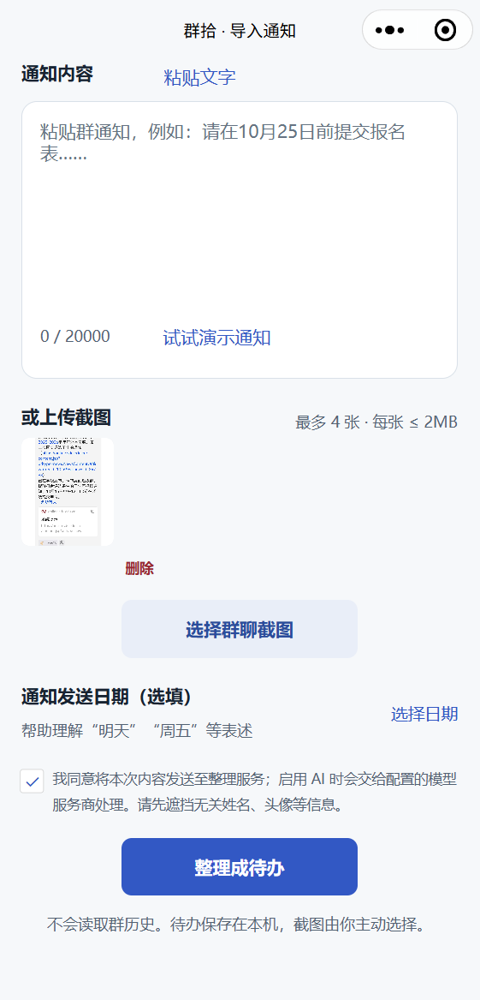
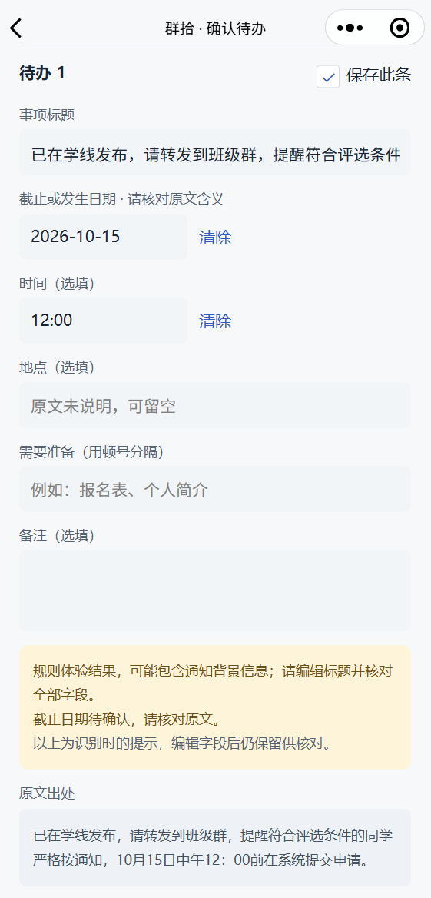
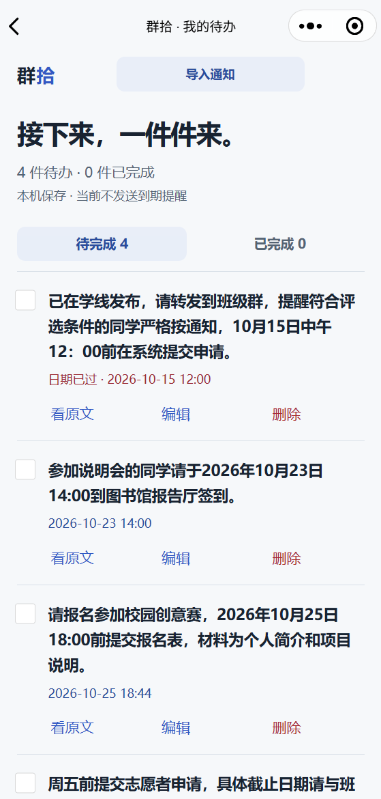
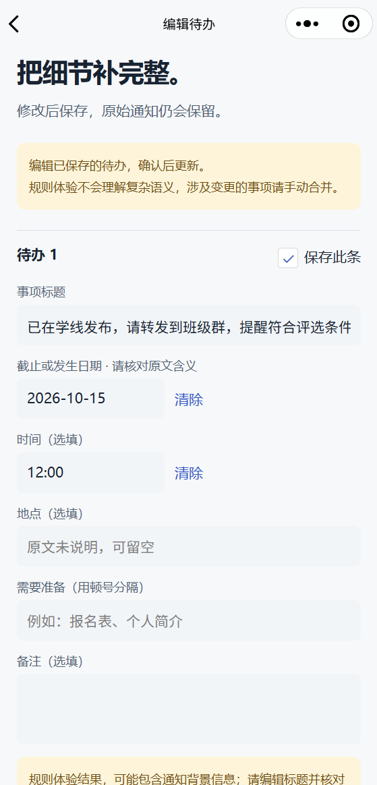

# 群拾 · Qunshi

**把群通知变成可确认、可追溯的待办。**

**Turn group notices into tasks you can review, edit, and trace back to the source.**

微信原生小程序 + Python 后端｜Native WeChat Mini Program + Python backend

[中文说明](#中文说明) · [English](#english) · [界面预览 / Screenshots](#界面预览--screenshots)

> 可运行原型：未配置模型时提供文字规则体验，AI 理解与截图识别需要自行配置模型。当前不发送到期提醒。
>
> Runnable prototype: text rules work without a key; AI extraction and screenshot recognition require a configured provider. Deadline notifications are not implemented.

## 界面预览 / Screenshots

当前原型的导入、核对、待办管理与编辑流程。截图包含规则体验与手动编辑结果，不代表 AI 识别准确率。

The current import, review, task list, and editing flows. Screenshots include rule-mode results and manual edits, rather than an AI accuracy benchmark.

<table>
  <tr>
    <td align="center"><strong>导入通知 · Import</strong><br/></td>
    <td align="center"><strong>确认待办 · Review</strong><br/></td>
  </tr>
  <tr>
    <td align="center"><strong>我的待办 · Tasks</strong><br/></td>
    <td align="center"><strong>编辑待办 · Edit</strong><br/></td>
  </tr>
</table>

## 中文说明

### 为什么做群拾

班级、社团和项目群里的报名、材料提交、集合通知很容易被聊天刷走。群拾让用户主动导入通知，先核对行动与时间，再保存为本机待办，需要时回到原文或原图确认细节。

**导入文字 / 截图 → 提取事项 → 人工核对 → 保存待办 → 查看原文 / 编辑 / 完成**

### 功能与边界

| 功能 | 当前实现 |
| --- | --- |
| 通知导入 | 粘贴文字、读取剪贴板、选择截图；最多 4 张，每张不超过 2MB |
| 无密钥体验 | 按行动关键词和明确日期整理文字，明确标注规则模式 |
| AI 提取 | 配置模型后提取标题、日期、时间、地点、材料和备注 |
| 截图识别 | 需要支持 `image_url` 的视觉模型；不提供离线 OCR |
| 人工确认 | 编辑字段、选择保存项、检查提示、核对完整原文和截图 |
| 待办管理 | 日期排序、完成 / 恢复、编辑、删除、查看通知来源 |
| 数据保存 | 待办、来源文字及原图保存在小程序本机存储 |

不会自动读取群历史或监听消息。当前没有登录、云同步、日历导出、微信订阅消息提醒。规则模式下复杂时间变更需手动合并。删除待办后来源文件仍保留，文件清理与配额管理尚待完善。

### 技术结构

```text
qunshi/
├── miniprogram/              # 微信原生前端 JS / WXML / WXSS / JSON
│   ├── pages/import/         # 导入通知
│   ├── pages/confirm/        # 核对、编辑、保存
│   ├── pages/tasks/          # 待办管理与原文
│   ├── utils/                # 请求、日期和本机存储
│   └── config.example.js     # 服务地址示例
├── server/
│   ├── main.py               # Python 标准库 HTTP 开发服务
│   ├── extractor.py          # 规则提取及模型调用
│   └── tests/                # 提取器测试
├── tests/                    # 页面流程、存储与文件完整性测试
├── docs/screenshots/         # 界面截图
├── project.config.example.json
└── .env.example              # 模型与后端环境变量示例
```

### 快速开始

准备 Python 3.11+、微信开发者工具和用于开发的 AppID 或测试号。测试脚本使用 Node.js 18+；前端不需要 npm 构建，后端不需要安装第三方 Python 包。

1. 克隆或下载本仓库，在根目录打开 PowerShell，创建本地配置：

   ```powershell
   Copy-Item project.config.example.json project.config.json
   Copy-Item miniprogram/config.example.js miniprogram/config.js
   ```

2. 在 `project.config.json` 中填写自己的 AppID。示例的 `touristappid` 是游客模式占位；若工具不支持，请使用测试号或有效 AppID。
3. 启动后端：

   ```powershell
   python server/main.py
   ```

4. 在微信开发者工具中导入**仓库根目录**，选择小程序，不启用云开发。模拟器默认连接 `http://127.0.0.1:8787`。
5. 仅在本地开发时，按需在工具的本地设置中启用“不校验合法域名、TLS 版本以及 HTTPS 证书”。
6. 点击“试试演示通知”，确认处理说明，再点击“整理成待办”。无需密钥即可体验文字规则流程。

已有本地配置时不要覆盖。`project.config.json`、`project.private.config.json`、`miniprogram/config.js`、`.env`、日志、安装包和构建产物不会被 Git 跟踪。

### 接入 AI

复制 `.env.example` 为 `.env`，编辑后重启后端：

```dotenv
AI_API_KEY=your_provider_api_key
AI_BASE_URL=https://your-provider.example/v1
AI_MODEL=your_model_id
HOST=127.0.0.1
PORT=8787
```

- `AI_BASE_URL` 是服务商 API 根地址；后端会追加 `/chat/completions`，不要重复填写该路径。
- 文本提取需要兼容 Chat Completions 的接口；截图需要支持 `image_url` 的视觉模型。模型应返回提示词要求的 JSON 结构，实际兼容性需自行验证。
- 未配置密钥时仅有文字规则模式，截图请求会提示配置模型。模型失败不会伪装成成功结果。
- 规则模式不理解复杂语义，只保守提取带年份的明确日期。AI 结果也需人工核对：提示词要求缺少通知发送日期时不猜相对日期，但不能保证模型始终遵循。
- 调用可能产生服务商费用。API 密钥仅保留在后端，不能放进小程序或提交到仓库。

### 手机调试

手机上的 `127.0.0.1` 指向手机本身，需要改为电脑可访问的地址：

1. 手机、电脑连接允许设备互访的同一 Wi-Fi。
2. 用 `ipconfig` 查询电脑 WLAN IPv4，将 `miniprogram/config.js` 的 `deviceUrl` 改为 `http://<电脑局域网IP>:8787`。
3. 在另一个 PowerShell 终端启动局域网服务，将占位内容替换为实际 IP：

   ```powershell
   $env:HOST = '<电脑局域网IP>'
   python server/main.py
   ```

4. 先用手机浏览器访问 `http://<电脑局域网IP>:8787/health`，看到 `"ok": true` 后重新编译、预览扫码。
5. 若浏览器打不开，检查后端是否运行、防火墙与网络设备隔离；若浏览器正常而小程序提示域名限制，开发测试时按需开启手机端调试。

网络切换后电脑 IP 可能改变。此后端无登录、鉴权和限流，仅用于可信网络内开发；正式发布需带访问控制、限流和 HTTPS 的后端，配置合法域名及相应隐私声明。

### 隐私与数据

通知和截图由用户主动选择。后端不把截图写入磁盘、不记录请求正文；配置 AI 后，输入会发送至所选模型服务商。上传前请遮挡无关姓名、头像及个人信息。待办及截图可能随清缓存、卸载而丢失，当前没有备份与跨设备同步。

### 验证

完成上述本地配置后运行：

```powershell
python -m unittest discover -s server/tests -v
node tests/storage.test.js
node tests/pages.test.js
node tests/page-manifest.test.js
```

覆盖日期与引文校验、模型异常响应、存储回滚、确认 / 保存 / 完成 / 查看原文流程、截图保存失败后的重试、页面文件完整性。模型测试使用模拟响应，不代表真实模型准确率或所有真机环境均已验证。

## English

### What Qunshi does

Registration deadlines, document requests, and meeting notices can disappear in busy group chats. Qunshi lets users explicitly import a notice, review its action and timing, then save a local task with access to the original text or image.

**Import text / screenshots → Extract → Review → Save → Trace the source / Edit / Complete**

### Features and scope

| Feature | Current implementation |
| --- | --- |
| Import | Paste text, read the clipboard, or select up to 4 screenshots, 2MB each |
| Key-free demo | Clearly labeled text rules using action keywords and explicit dates |
| AI extraction | Configurable model for titles, dates, times, locations, materials, and notes |
| Screenshot recognition | Requires a vision model accepting `image_url`; no offline OCR |
| Human review | Edit fields, select tasks, inspect warnings, and compare with source text or images |
| Task management | Sort by date, complete / restore, edit, delete, and inspect sources |
| Persistence | Tasks, source text, and screenshots are saved on the device |

The app does not read chat history or monitor messages. Authentication, cloud sync, calendar export, and deadline notifications are not implemented. Complex changes need manual merging in rule mode. Source files currently remain after task deletion; cleanup and quota management are pending.

### Stack

Native WeChat Mini Program (JavaScript, WXML, WXSS, JSON), a Python standard-library HTTP server, a configurable Chat Completions-compatible model provider, and local WeChat storage. No frontend npm build or third-party Python dependencies are required. Node.js is used for JavaScript tests only. See the directory tree above for the source layout.

### Quick start

Requirements: Python 3.11+, WeChat DevTools, and a development AppID or test account. Tests use Node.js 18+.

1. Clone or download the repository. In a PowerShell terminal at its root, create local configuration:

   ```powershell
   Copy-Item project.config.example.json project.config.json
   Copy-Item miniprogram/config.example.js miniprogram/config.js
   ```

2. Enter your AppID in `project.config.json`. The example `touristappid` is a guest-mode placeholder; use a test account or valid AppID if required by your tool version.
3. Start the backend:

   ```powershell
   python server/main.py
   ```

4. Import the **repository root** into WeChat DevTools as a Mini Program without cloud development. The simulator uses `http://127.0.0.1:8787`.
5. For local development only, enable the tool's option to skip domain, TLS-version, and certificate checks where needed.
6. Select the sample notice, confirm the content-processing notice, and extract tasks. Text rules work without an API key.

Do not overwrite existing local configuration. Local AppID and service configuration, `.env`, logs, installers, and build artifacts are excluded from Git.

### Configure AI

Copy `.env.example` to `.env`, edit it, and restart the backend:

```dotenv
AI_API_KEY=your_provider_api_key
AI_BASE_URL=https://your-provider.example/v1
AI_MODEL=your_model_id
HOST=127.0.0.1
PORT=8787
```

`AI_BASE_URL` is the provider API root; the backend appends `/chat/completions`. Text extraction needs a compatible message API. Screenshots need a vision model accepting `image_url`. Responses must follow the prompted JSON structure; verify your provider's compatibility.

Without a key, only text rules are available. Screenshot requests explain the missing model configuration, and failed model calls return errors rather than fabricated success. Rules do not understand complex semantics and only conservatively extract explicit dates with a year. AI output also requires review: the prompt asks the model not to guess relative dates without the notice date, but compliance is not guaranteed.

Provider charges may apply. Keep API keys on the backend, outside the Mini Program and Git history.

### Test on a phone

On a phone, `127.0.0.1` refers to the phone itself:

1. Connect the phone and computer to the same Wi-Fi with device-to-device access.
2. Find the computer's WLAN IPv4 with `ipconfig`. Set `deviceUrl` in `miniprogram/config.js` to `http://<COMPUTER_LAN_IP>:8787`.
3. Start the LAN server in another PowerShell terminal, replacing the placeholder:

   ```powershell
   $env:HOST = '<COMPUTER_LAN_IP>'
   python server/main.py
   ```

4. Open `http://<COMPUTER_LAN_IP>:8787/health` in the phone browser. After receiving `"ok": true`, recompile and scan the preview QR code.
5. If the browser cannot connect, check the server, firewall, and Wi-Fi client isolation. If the browser works but WeChat reports a domain restriction, enable phone-side debugging for development where needed.

The computer's address may change with its network. This unauthenticated server has no rate limiting; use it only on trusted development networks. Production requires an HTTPS backend with access controls and rate limiting, approved request domains, and appropriate privacy disclosures.

### Privacy and persistence

Users explicitly select content. The backend does not persist screenshots to disk or log request bodies. When AI is configured, inputs are sent to the chosen provider. Remove unrelated names, avatars, and personal information before uploading. Local tasks and images may be lost when app storage is cleared or the app is removed; backup and cross-device sync are unavailable.

### Tests

After creating local configuration files:

```powershell
python -m unittest discover -s server/tests -v
node tests/storage.test.js
node tests/pages.test.js
node tests/page-manifest.test.js
```

Tests cover date and quotation validation, malformed model responses, storage rollback, review/save/complete/source flows, screenshot-save retries, and required page files. Model calls are mocked; these tests do not measure real model accuracy or certify every device environment.
